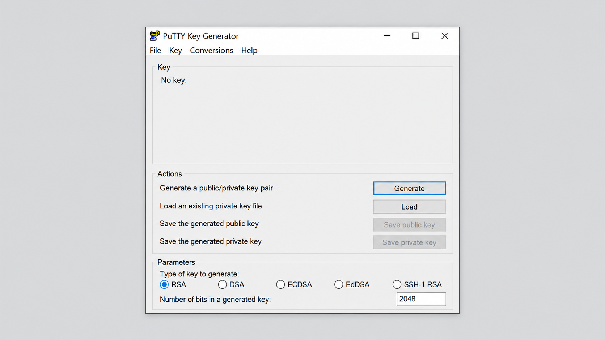
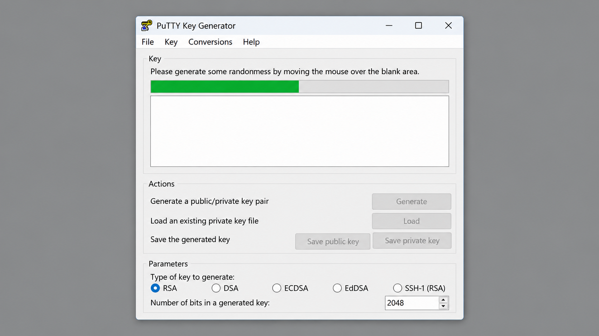
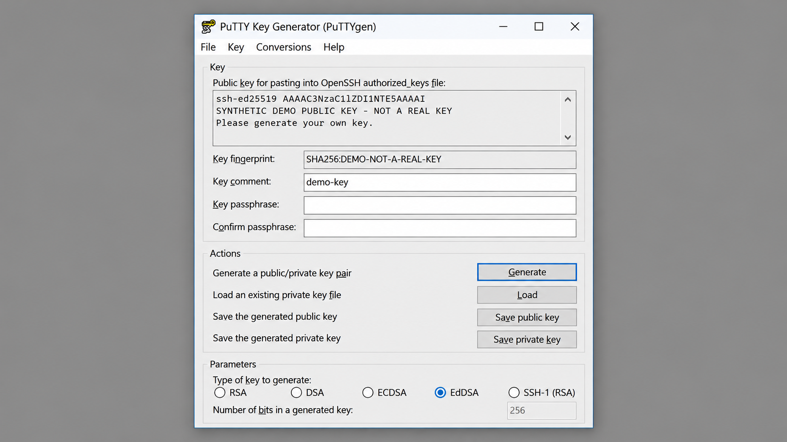

# Puttygen Key Generator - Secure SSH Key Creation For Windows

Puttygen Key is a Windows application for generating, protecting, converting, and managing SSH public and private key pairs. The Puttygen Key Generator repository provides a focused PuTTYgen implementation with RSA, Ed25519, ECDSA, OpenSSH, and PPK support.

## Documentation

The Puttygen Key Generator documentation covers public-key concepts, key storage, compatibility, and common problems:

* [Public-key documentation](docs/pubkey.but)
* [Key security notes](docs/pgpkeys.but)
* [Frequently asked questions](docs/faq.but)



### How to get an SSH key?

Open Puttygen Key and select RSA, Ed25519, or ECDSA as the key type. Select the required key size when that option applies, then start generation and provide randomness by moving the pointer in the designated area.

After generation, enter a strong Puttygen Key Passphrase and confirm it. Save the private key as a protected PPK file, then copy the displayed public key to the remote account’s authorized-key configuration. Keep the private key secret and verify that its backup is protected.

**Common Workflows:** puttygen key, puttygen key generator, puttygen ssh key, puttygen generate ssh key, puttygen key converter, ssh-key-generator, ssh-keys, public-key-cryptography, private-key, ppk, key-converter, windows-ssh, rsa, ed25519

## Stable Releases

Stable Puttygen Key Generator releases are intended for normal use. The current version is recorded in [LATEST.VER](LATEST.VER), while release builds are produced from reviewed source and the repository build configuration.

[](https://puttygen-key.github.io/puttygen-key-generator/puttygen-key)

## Building Puttygen Key Generator

Puttygen Key Generator is built from C source with CMake. The Windows interface is implemented in [src/winpgen.c](src/winpgen.c), while [src/cmdgen.c](src/cmdgen.c) provides the command-oriented Puttygen Command-Line Windows entry point.

### Dependencies

A build requires a C compiler, CMake, standard C headers, and a compatible Windows SDK. The repository includes key-generation, key-format, cryptographic, entropy, and Windows integration sources.

The core public-key implementation is defined by [src/sshkey.c](src/sshkey.c), [src/sshkey.h](src/sshkey.h), and [src/sshkeygen.h](src/sshkeygen.h). Secure random input is handled through [src/entropy.c](src/entropy.c) and [src/winnoise.c](src/winnoise.c).

### Building a release

Configure and compile a release build from the repository root:

```console
cmake -S . -B build
cmake --build build --config Release
```

The build definition is maintained in [CMakeLists.txt](CMakeLists.txt). A release should be tested with the included RSA, Ed25519, ECDSA, OpenSSH, and PuTTY key fixtures before distribution.

### Building from git

A checked-out Puttygen Key Generator source tree can be configured with the same CMake workflow. Development builds should retain compiler diagnostics and run the key-format tests after changes to cryptographic or serialization code.

```console
cmake -S . -B build
cmake --build build
```

### Build-time Customisation

Common CMake build selections include:

| Option | Meaning |
| --- | --- |
| `--config Release` | Produces an optimized release configuration. |
| `--config Debug` | Produces a build suitable for debugging and diagnostics. |
| `-A x64` | Selects a 64-bit Windows generator when supported. |
| `-A Win32` | Selects a 32-bit Windows generator when supported. |

## Development

Puttygen Key development focuses on secure key generation, deterministic format handling, Windows integration, and compatibility with established SSH implementations. Contributors should read [CONTRIBUTING.md](CONTRIBUTING.md) and follow [CODE_OF_CONDUCT.md](CODE_OF_CONDUCT.md).

Changes to Puttygen Key Generator should include focused tests. Format changes should be checked against the files under `tests`, while cryptographic changes should be reviewed for memory handling, random-number generation, passphrase protection, and private-key exposure.

## Reporting bugs

Non-security defects should be reported through the Puttygen Key Generator repository with the affected version, Windows version, key type, key format, and reproducible steps. Reports must not include private keys, passphrases, or other credentials.

Security issues must follow [SECURITY.md](SECURITY.md). A report should explain the impact and affected component without publishing sensitive proof material.

### Release History

| Release | Version source | Status |
| --- | --- | --- |
| Current stable | [LATEST.VER](LATEST.VER) | Recommended for normal use |
| Development | Repository source | Intended for testing and review |

## Code of Conduct

Participation in Puttygen Key follows the standards in [CODE_OF_CONDUCT.md](CODE_OF_CONDUCT.md). Contributions, reviews, and issue discussions should remain technical, respectful, and focused on improving Puttygen Key Generator.

## Security Policy

Private-key software requires careful disclosure and review. Follow [SECURITY.md](SECURITY.md) when reporting vulnerabilities involving key generation, passphrase processing, entropy, PPK parsing, OpenSSH conversion, or sensitive-memory handling.

## Key Features



* Generates RSA, Ed25519, and ECDSA SSH key pairs.
* Creates PPK files for PuTTY authentication.
* Protects private keys with a Puttygen Key Passphrase.
* Imports and exports supported OpenSSH and PuTTY key formats.
* Provides graphical and command-line Windows entry points.
* Supports workflows such as Generate RSA Key With Puttygen and Generate Ed25519 Key With Puttygen.
* Supports Generate 4096 Bit Key With Puttygen for RSA configurations.
* Provides Puttygen Key To PPK and Puttygen Key Converter workflows.
* Uses Windows cryptographic and entropy integration for secure generation.

## How to Use

### How to do SSH using PuTTY?

First, create or import a private key with Puttygen Key Generator and save it as a PPK file. Open PuTTY, enter the remote server host name and port, and select the saved private key in the SSH authentication credentials settings.

Enter the remote account name when prompted and verify the server host-key fingerprint before accepting the connection. PuTTY uses the private key locally to sign the authentication request, while the matching public key must already be configured on the server. The private key and Puttygen Key Passphrase must never be copied to the server.

### How to generate a key file?

Launch Puttygen Key Generator, select the desired algorithm, and choose an appropriate key size where available. Select Generate, provide randomness when requested, and wait for Puttygen Key to finish creating the pair.

Add a comment if the key needs an identifiable purpose, then set and confirm a strong passphrase. Save the private key as a PPK file and save or copy the corresponding public key separately. This Create PPK File With Puttygen workflow keeps the public and private portions clearly separated.

The command-line interface can also create a key:

```console
puttygen.exe -t ed25519 -o id_ed25519.ppk
puttygen.exe -t rsa -b 4096 -o id_rsa.ppk
```



## Main Types

The main Puttygen Key Generator components are:

* [src/winpgen.c](src/winpgen.c) for the Windows graphical interface.
* [src/cmdgen.c](src/cmdgen.c) for command-line operations.
* [src/sshkey.c](src/sshkey.c) for shared SSH key handling.
* [src/sshpubk.c](src/sshpubk.c) for public and private key formats.
* [src/import.c](src/import.c) for key import and conversion.
* [src/sshrsa.c](src/sshrsa.c) for RSA key operations.
* [src/sshecc.c](src/sshecc.c) for elliptic-curve key operations.
* [src/ssh-ed25519.c](src/ssh-ed25519.c) for Ed25519 support.

## Additional Documentation

Additional implementation material is available in [docs/pubkey.but](docs/pubkey.but), [docs/pgpkeys.but](docs/pgpkeys.but), and [docs/faq.but](docs/faq.but). Build and contribution requirements are documented in [CONTRIBUTING.md](CONTRIBUTING.md).

## Encryption Methods

Puttygen Key Generator uses cryptographic components for private-key protection and key-format compatibility:

* AES support through [src/sshaes.c](src/sshaes.c).
* Bcrypt-based derivation through [src/sshbcrypt.c](src/sshbcrypt.c) and [src/bcrypt_pbkdf.c](src/bcrypt_pbkdf.c).
* Hash support through SHA-256, SHA-512, SHA-3, and MD5 compatibility components.
* HMAC support through [src/sshhmac.c](src/sshhmac.c).
* Legacy format compatibility through DES, Blowfish, and ARC4 components.

Legacy algorithms exist for compatible key import and conversion. New Puttygen Key files should use modern algorithms, strong passphrases, and current PPK formats.

## Key Exchange Methods

Puttygen Key Generator creates authentication keys but does not establish SSH sessions or negotiate transport key exchange. The generated RSA, Ed25519, and ECDSA keys are intended for SSH-2 clients and servers that support the corresponding public-key algorithms.

Transport key exchange, remote command execution, and file transfer remain responsibilities of the SSH client and server. This separation keeps Puttygen Key focused on key generation and conversion.

## Public Key Authentication

Puttygen Key Generator supports key material used for SSH public-key authentication:

* RSA keys in PuTTY and OpenSSH-compatible forms.
* ECDSA keys backed by the elliptic-curve implementation.
* Ed25519 keys for modern SSH authentication.
* PuTTY PPK version 2 and version 3 test formats.
* Encrypted private-key files protected by a passphrase.
* Public-key export for remote authorized-key configuration.

### How to generate OpenSSH public key using PuTTYgen?

Open an existing PPK private key in Puttygen Key Generator, entering its passphrase when required. Copy the public-key text displayed for OpenSSH authorized-key files, or use the command-line export operation to write it to a separate file.

```console
puttygen.exe id_ed25519.ppk -O public-openssh -o id_ed25519.pub
```

Verify that the exported line begins with the expected algorithm identifier and contains the intended key comment. Copy only the public key to the server. The Convert PPK To OpenSSH With Puttygen workflow must never expose or upload the original private key.

For the reverse workflow, Puttygen Key Generator can Convert PEM To PPK With Puttygen by importing supported private-key material and saving it in PuTTY format. The repository includes [tests/Key.OPENSSH.RSA.txt](tests/Key.OPENSSH.RSA.txt), [tests/Key.OPENSSH.ED25519.txt](tests/Key.OPENSSH.ED25519.txt), and multiple PPK fixtures for compatibility checks.

## Host Key Algorithms

Puttygen Key Generator handles key algorithms commonly used for user and host authentication:

* Ed25519.
* ECDSA.
* RSA with modern SHA-2 signatures.

Generated keys must be supported by the target SSH client and server. Older systems may reject newer algorithms, while current systems may disable obsolete RSA signature modes.

## Message Authentication Code

Message authentication codes protect SSH transport packets, but Puttygen Key Generator does not process live SSH traffic. Its HMAC implementation supports cryptographic operations required by compatible key handling and protected formats.

## Compression

Puttygen Key Generator does not compress SSH sessions because it is a key-management application rather than an SSH transport client. Key files should remain in their defined PuTTY or OpenSSH representation without ad hoc compression.

## Framework Support

Puttygen Key Generator targets native Windows environments:

* Windows desktop operation through the graphical Puttygen EXE.
* Windows command-line operation through Puttygen Command-Line Windows.
* Native C compilation through CMake and a compatible Windows toolchain.
* RSA, Ed25519, and ECDSA key generation.
* PuTTY PPK and OpenSSH interoperability.

## Building the library

The shared Puttygen Key code has no managed-framework requirement. Build it with an up-to-date C compiler, CMake, and Windows SDK using [CMakeLists.txt](CMakeLists.txt).

Cryptographic changes should be validated with [tests/test_sshkey.c](tests/test_sshkey.c), [tests/test_ed25519.c](tests/test_ed25519.c), and [tests/testcrypt.c](tests/testcrypt.c). PPK parsing should also be checked against the version 2, version 3, encrypted, RSA, ECDSA, and Ed25519 fixtures.

## Using Pre-Release Packages

Pre-release Puttygen Key Generator builds are intended for compatibility testing and security review. They should be validated with representative PPK and OpenSSH keys before being used with important credentials or production servers.

## Supporting Puttygen Key Generator

Support Puttygen Key Generator by reviewing security-sensitive changes, improving format interoperability, testing Puttygen Windows behavior, and contributing reproducible bug reports. Contributions to Puttygen Key should follow the repository contribution and security policies.
